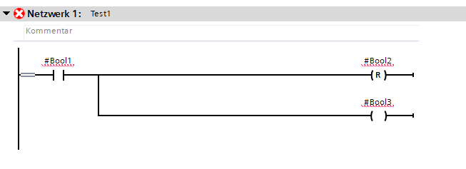
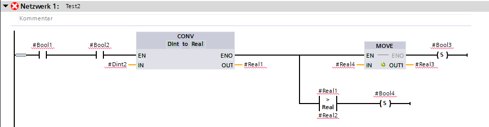
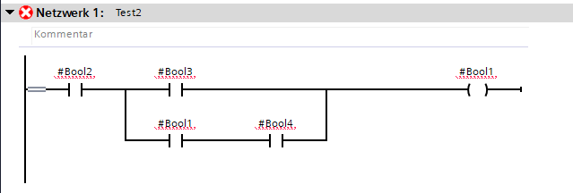

# TiaCodeGen
Library to Generate TIA KOP Code via C#

# Samples

```csharp
            var codeblock = new CodeBlock();
            var nw = new Network("Test1", "Test1en");

            nw.Add(
                new And(
                    new Signal("#Bool1"),
                new Distributor
                (
                    new RCoil(new Signal("#Bool2")),
                    new Coil(new Signal("#Bool3"))
                )));

            codeblock.Add(nw);

            var block = new Block("Test", "blabla", codeblock);
            block.Interface = TestInterface;
            var xml = block.GetCode();
```

This will create following



```csharp
            var codeblock = new CodeBlock();

            var nw = new Network("Test2", "Test2en");
            nw.Add(
                new And(
                    new Signal("#Bool1"),
                    new Signal("#Bool2"),
                    new Convert(
                        new Signal("#Real1", SignalType.Real),
                        new Signal("#Dint2", SignalType.DInt)
                    ),
                    new Distributor(
                        new And(
                            new Move(
                                new Signal("#Real3"),
                                new Signal("#Real4")
                            ),
                            new SCoil(new Signal("#Bool3"))
                        ),
                        new And(
                            new Gt(
                                new Signal("#Real1", SignalType.Real),
                                new Signal("#Real2", SignalType.Real)
                            ),
                            new SCoil(new Signal("#Bool4"))
                        )
                    )
                )
            );

            codeblock.Add(nw);

            var block = new Block("Test", "blabla", codeblock);
            block.Interface = TestInterface;
            var xml = block.GetCode();
```

This will create following



```csharp
            var codeblock = new CodeBlock();

            var nw = new Network("Test2", "Test2en");
            nw.Add(
                new Coil(
                    new Signal("#Bool1"),
                    new And(
                        new Signal("#Bool2"),
                        new Or(
                             new Signal("#Bool3"),
                             new And(
                                new Signal("#Bool1"),
                                new Signal("#Bool4")
                            )
                        )
                    )
                )
            );

            codeblock.Add(nw);

            var block = new Block("Test", "blabla", codeblock);
            block.Interface = TestInterface;
            var xml = block.GetCode();
```

This will create following


